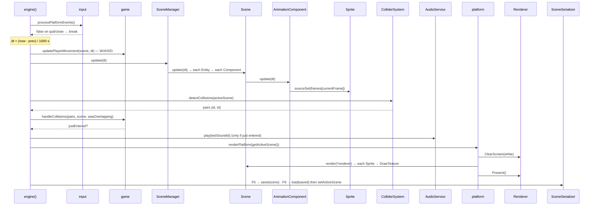

# A Frame in the Engine

> **Coverage:** Verified · **Checked against:** `phase3` @ `ca2b728`

**In one sentence:** Each loop iteration reads events, computes `dt`, moves the player, updates the scene (animations), detects collisions, checks whether the player just entered the trigger (sound), draws, and finally handles F5 save / F9 reload.

## Flow diagram

## Walkthrough

| # | Function that runs | Why it runs | What changes / result |
| --- | --- | --- | --- |
| 1 | [`processPlatformEvents`](../code/input.md#processplatformevents) | Read OS events | Pressed/released arrays; returns false to stop |
| 2 | (inline in [`engine`](../code/engine.md#engine)) | Frame-rate-independent timing | `delta_time` in seconds |
| 3 | [`updatePlayerMovement`](../code/game.md#updateplayermovement) | Gameplay input | Player's Transform moves 200 px/s per held key |
| 4 | [`SceneManager::update`](../code/scene-manager.md#scenemanager-update) → [`Scene::update`](../code/scene.md#scene-update) → [`Entity::update`](../code/entity.md#entity-update) | Reach every component | Creation order |
| 5 | [`AnimationComponent::update`](../code/animation-component.md#animationcomponent-update) | Advance the animation clock | Picks a frame; calls [`Sprite::sourceSet`](../code/sprite.md#sprite-sourceset) |
| 6 | [`ColliderSystem::detectCollisions`](../code/collider-system.md#collidersystem-detectcollisions) | Find overlaps at this frame's positions | Vector of ID pairs |
| 7 | [`handleCollisions`](../code/game.md#handlecollisions) | Turn "overlapping" into "just entered" | `wasOverlapping` updated; on entry: log + [`AudioService::play`](../code/audio-service.md#audioservice-play) |
| 8 | [`renderEngineFrame`](../code/engine.md#renderengineframe) → [`renderPlatform`](../code/platform.md#renderplatform) | Draw | Clears to white |
| 9 | [`Scene::render`](../code/scene.md#scene-render) → [`Entity::render`](../code/entity.md#entity-render) → [`Sprite::render`](../code/sprite.md#sprite-render) | Each sprite draws itself | [`DrawTexture`](../code/renderer.md#renderer-drawtexture) with dest = Transform, src = current frame |
| 10 | [`Renderer::Present`](../code/renderer.md#renderer-present) | Show the frame | Waits for vsync |
| 11 | F5: [`SceneSerializer::save`](../code/scene-serializer.md#sceneserializer-save) · F9: [`load`](../code/scene-serializer.md#sceneserializer-load) + [`setActiveScene`](../code/scene-manager.md#scenemanager-setactivescene) | Save/reload at the frame boundary | File written, or scene replaced and `wasOverlapping = false` |

## Important ordering facts

- **Move before update before collisions:** collisions see this frame's final positions.
- **Collisions before render**, so a reaction would show in the same frame.
- **Update before render**, so the first frame drawn already has the animation's frame 0.
- **Save/reload last:** the scene is only swapped when nothing else in the frame is using it.
- **Creation order = draw order.** Later entities appear on top (the player is drawn last).
- **Vsync** in `Present()` paces the loop to the display refresh rate.

## Error and exit paths

| Situation | What happens |
| --- | --- |
| Quit or close event | The loop `break`s; the scene is destroyed at the end of the scope; `shutdownPlatform()` |
| Platform start-up fails | `engine()` logs an Error and returns (the platform already cleaned up) |
| Demo JSON missing or invalid at start-up | Caught in `engine()`; logged as `Engine error: …`; `shutdownPlatform()` still runs |
| Bad texture handle / bad source rect | Logged warning; that sprite isn't drawn; the loop continues |
| Sound failed to load or play | `testSoundId` is 0 / warning logged; the loop continues |
| Player stays inside the trigger | No repeat: the sound plays only on entry |
| F5 save fails | Error logged; game continues; old save file untouched |
| F9 with no save, or a bad save | Warning / Error logged; **current scene stays** |

## Related code

[Symbol index](../code/symbol-index.md) · [Architecture overview](index.md) · [Ownership](ownership.md) · [Tests](../tests/index.md)
