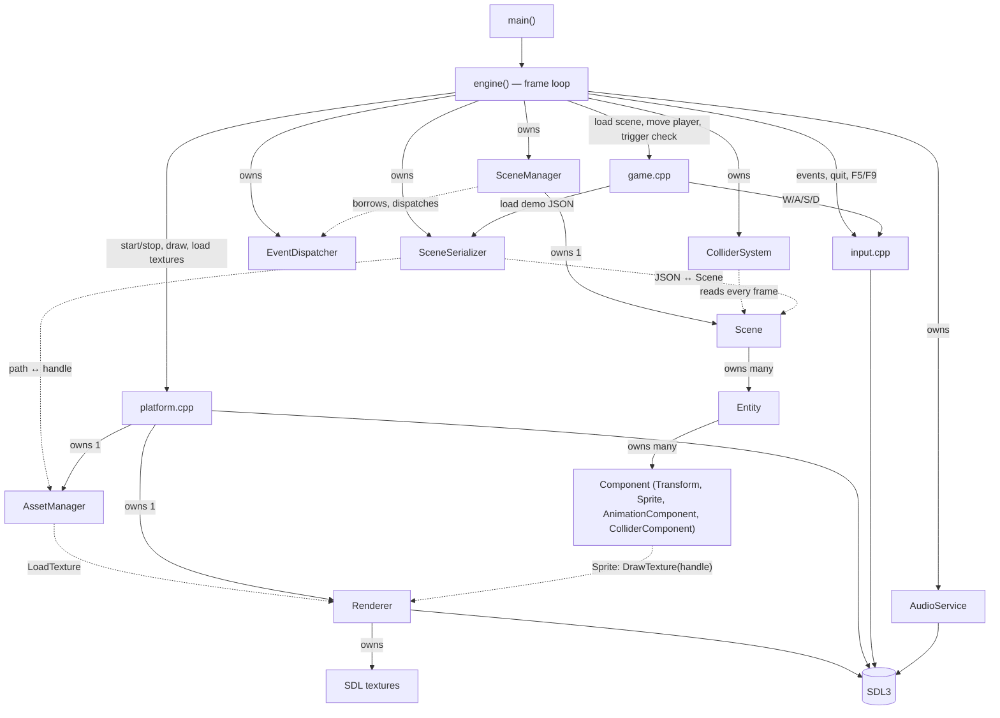

# Architecture Overview

> **Coverage:** Verified · **Checked against:** `phase3` @ `ca2b728`

**In one sentence:** A small layered engine. A frame loop drives a scene of entities made of components, engine systems (collision, audio) work on that scene, and a platform layer hides SDL behind a `Renderer`.

## Big picture

The demo scene comes from `assets/scenes/phase3-demo.json`, loaded through the platform's `AssetManager`.

**How to read this:** solid arrows are **ownership or direct calls**; dotted arrows are **borrowed references** (no ownership).

## Layers

| Layer | Files | Knows about SDL? |
| --- | --- | --- |
| Entry / loop | [main, engine](../code/engine.md) | Only through platform/input functions |
| Gameplay | [game](../code/game.md) (`createGameScene`, `updatePlayerMovement`, `handleCollisions`) | No |
| Scene & ECS | [SceneManager](../code/scene-manager.md), [Scene](../code/scene.md), [Entity](../code/entity.md), [Component](../code/component.md), [Transform](../code/transform.md), [Sprite](../code/sprite.md), [AnimationComponent](../code/animation-component.md), [ColliderComponent](../code/collider-component.md) | **No.** They use [render types](../code/render-types.md) and a `Renderer&` |
| Engine systems | [ColliderSystem](../code/collider-system.md), [AudioService](../code/audio-service.md) | Collider: no. Audio: only inside its `.cpp` (pimpl) |
| Data & assets | [SceneSerializer](../code/scene-serializer.md), [AssetManager](../code/asset-manager.md) | No (AssetManager talks to `Renderer`) |
| Events | [EventDispatcher](../code/event-dispatcher.md) | No |
| Platform | [platform](../code/platform.md), [input](../code/input.md), [logger](../code/logger.md) | Yes (except the logger) |
| Rendering | [Renderer](../code/renderer.md) | Yes. `renderer.h` is the header that includes SDL. |

**SDL-free headers:** `rendertypes.h`, `component.h`, `entity.h`, `transform.h`, `sprite.h`, `animationComponent.h`, `colliderComponent.h`, `colliderSystem.h`, `audio_service.h`, `asset_manager.h`, `scene_serializer.h`, `scene.h`, `scene_manager.h`, `event_dispatcher.h`, `game.h`, `platform.h` (it forward-declares `Renderer`), `logger.h`, `input.h`.

## Who owns what

| Object | Owner | How | Destroyed when |
| --- | --- | --- | --- |
| SDL window | platform global `window` | raw pointer | [`shutdownPlatform`](../code/platform.md#shutdownplatform) or an init failure |
| `Renderer` | platform global `renderer` | `unique_ptr` | `shutdownPlatform`, **before** the window |
| SDL textures | `Renderer::textures` | raw pointers in a vector | `~Renderer` |
| `AudioService` (+ SDL audio stream) | local in `engine()` | stack (stream inside a pimpl) | end of the inner scope, **last** |
| `EventDispatcher` | local in `engine()` | stack | end of the inner scope, **after** the SceneManager |
| `ColliderSystem` | local in `engine()` | stack (no state) | end of the inner scope |
| `SceneManager` | local in `engine()` | stack | end of the inner scope, **first** |
| `AssetManager` | platform global `assetManager` | `unique_ptr` | `shutdownPlatform`, **before** the Renderer it borrows |
| Active `Scene` | `SceneManager::currentScene` | `unique_ptr` | replaced, or the manager is destroyed |
| `Entity` | `Scene::entities` | `unique_ptr` each | the scene is destroyed |
| Components | `Entity::components` | `unique_ptr<Component>` each | the entity is destroyed |

**Borrowed (non-owning) links:** `Component::owner` → Entity; `SceneManager::eventDispatcher` → dispatcher; `AssetManager::renderer` → Renderer; `Sprite::currentTexture` is a **number**, not a pointer, so it can't dangle in memory terms.

See [ownership and lifetime](ownership.md) for the full start-up and shutdown order.

## Answers to the key questions

- **Where does execution start?** `main()` → [`engine()`](../code/engine.md#engine).
- **What stops the loop?** [`processPlatformEvents`](../code/input.md#processplatformevents) returns false on `SDL_EVENT_QUIT` or `SDL_EVENT_WINDOW_CLOSE_REQUESTED`.
- **How do update and render travel?** `SceneManager::update` → `Scene::update` → `Entity::update` → each `Component::update`. Then `ColliderSystem::detectCollisions` reads the scene and `handleCollisions` reacts. Rendering goes `renderPlatform` → `Scene::render` → `Entity::render` → each `Component::render`. See the [frame flow](frame-flow.md).
- **Where do scenes come from?** [`SceneSerializer::load`](../code/scene-serializer.md#sceneserializer-load) builds a new scene from JSON: at start-up (`phase3-demo.json`) and on F9 (`phase3-demo-saved.json`). F5 writes the current scene with `save`.
- **Events:** only `SceneChangedEvent`, dispatched synchronously by [`setActiveScene`](../code/scene-manager.md#scenemanager-setactivescene). Nothing in the game subscribes yet.
- **Failure paths:** start-up failure cleans itself up and `engine()` returns. Any exception after that (e.g. a missing texture) is caught in `engine()`, logged, and `shutdownPlatform()` still runs. Sound problems are never exceptions.

**Next:** [A frame in the engine](frame-flow.md) · [Ownership and lifetime](ownership.md) · [File reference](../code/index.md)
