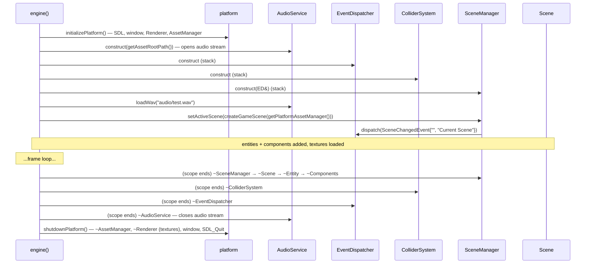

# Ownership and Lifetime — How It Works

> **Coverage:** Verified · **Checked against:** `phase3` @ `ca2b728`

**In one sentence:** Things are created in the order platform → audio → dispatcher → collider system → manager → scene → entities → components, and destroyed in the reverse order, so nothing points at something already gone.

**Why this path matters:** Most C++ crashes come from using an object after its owner freed it. This page shows why the current order is safe, and what new code must respect.

## Flow diagram

## Walkthrough

| # | Function that runs | Why it runs | What changes / result |
| --- | --- | --- | --- |
| 1 | [`initializePlatform`](../code/platform.md#initializeplatform) | Everything else needs a renderer | SDL, window, `Renderer` and `AssetManager` exist |
| 2 | [`AudioService` ctor](../code/audio-service.md#audioservice-audioservice) | Sound needs SDL audio (started by the platform) | Declared **first** in the scope, so destroyed **last**, still before `SDL_Quit` |
| 3 | `EventDispatcher` ctor, `ColliderSystem` ctor | The manager needs the dispatcher | Dispatcher declared **before** the manager, so it outlives it |
| 4 | [`SceneManager` ctor](../code/scene-manager.md#scenemanager-scenemanager) | Holds the active scene | Borrows the dispatcher |
| 5 | [`createGameScene`](../code/game.md#creategamescene) | Load the demo JSON **before** handing it over | Scene owns entities; entities own components; textures loaded and cached |
| 6 | [`setActiveScene`](../code/scene-manager.md#scenemanager-setactivescene) | Install the scene | Old scene (none) destroyed; event sent |
| 7 | End of `{ }` in [`engine`](../code/engine.md#engine) | Scene objects must die before the renderer | Components → entities → scene → manager → collider system → dispatcher → audio |
| 8 | [`shutdownPlatform`](../code/platform.md#shutdownplatform) | Release SDL | AssetManager → textures → renderer → window → SDL |

## Ownership and state

- **Textures vs sprites:** sprites store a [`textureHandle`](../code/render-types.md#rendertypes-texturehandle) (a number). The [Renderer](../code/renderer.md#renderer-textures) owns the actual `SDL_Texture*`. Textures stay loaded for the whole run (**retained**, never unloaded early).
- **Back-pointers:** `Component::owner` is safe because entities can't be copied or moved, and components die with their entity.
- **AssetManager:** owned by the platform; it **maps** paths ↔ handles but owns no textures. It borrows the Renderer, so `shutdownPlatform` destroys it first.
- **F9 reload:** the new scene is fully built first; `setActiveScene` then destroys the old one. Anything holding the old scene's entities (like `wasOverlapping`'s meaning) must be reset, which `engine()` does.
- **Loaded scenes:** [`SceneSerializer::load`](../code/scene-serializer.md#sceneserializer-load) returns a `unique_ptr<Scene>` that nobody else knows about yet. If loading fails, that half-built scene is destroyed inside `load`, and the active scene is untouched.
- **Events carry copies:** `SceneChangedEvent` holds `std::string` copies, so the names survive the old scene's destruction.

## Rules for new code

1. Anything holding a `Renderer&` (like an `AssetManager`), an `SDL_*` pointer, an audio stream or a texture **pointer** must be destroyed **inside** the `engine()` scope, before `shutdownPlatform()`.
2. Anything holding an `EventDispatcher&` must be declared **after** the dispatcher.
3. Don't keep `Entity&`, `Component*` **or entity IDs** across a scene switch: the old scene's objects are destroyed by `setActiveScene`, and IDs restart at 1 in every scene.

## Alternatives and exits

- Start-up failure: nothing beyond the platform was created, and the platform cleaned itself up.
- An exception thrown during scene set-up or the loop unwinds the inner scope (destroying the systems in reverse order), is caught and logged by `engine()`, and then `shutdownPlatform()` runs normally.

## What to read next

[Architecture overview](index.md) · [Frame flow](frame-flow.md) · [Platform](../code/platform.md) · [SceneManager tests](../tests/test-scene.md)
