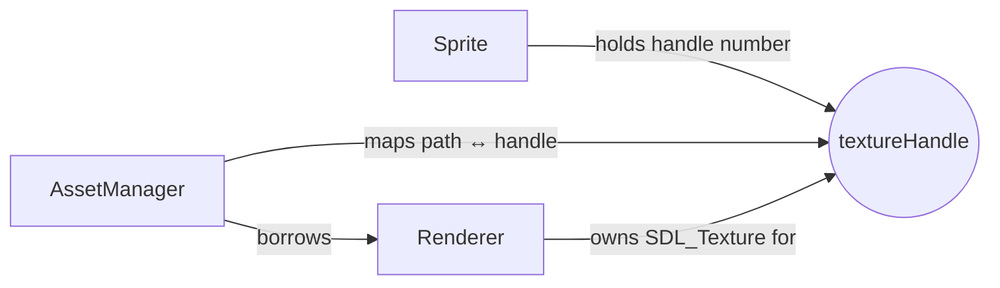

# AssetManager — Source Reference

> **Coverage:** Verified · **Source revision:** `phase3` @ `ca2b728` · **Last checked:** 2026-11-05
>
> **Files:** [`include/asset_manager.h`](../../include/asset_manager.h) and [`src/asset_manager.cpp`](../../src/asset_manager.cpp).

**In one sentence:** Turns an **asset-relative path** like `"sprites/cat.bmp"` into a texture handle, loading each file only once, and can turn the handle back into the path.

**Why it exists:** Scene files must store **paths** (handles are just numbers that change every run), while the running game needs **handles**. The AssetManager is the two-way dictionary between them, and its cache means two sprites using the same file share one texture.

## At a glance

| This code… | Explanation |
| --- | --- |
| Is responsible for | Path validation/normalisation, the path ↔ handle cache, texture size lookup |
| Gets information from | Its asset root folder; the [Renderer](renderer.md) |
| Changes | Its two maps; the Renderer's texture list (through `LoadTexture`) |
| Used by | The platform (owns **the** engine instance, see [`getPlatformAssetManager`](platform.md#getplatformassetmanager)); [SceneSerializer](scene-serializer.md) (`load` uses `loadTexture`, `save` uses `getPath`); tests |
| Depends on | [Renderer](renderer.md), [render types](render-types.md) |

## Contents

| Symbol | What it means | Jump |
| --- | --- | --- |
| `AssetManager` | Path ↔ handle cache | [Class](#class-assetmanager) |
| `AssetManager(Renderer&, path)` | Create with a renderer and root folder | [Function](#assetmanager-assetmanager) |
| `loadTexture(path)` | Cached load | [Function](#assetmanager-loadtexture) |
| `getPath(handle)` | Handle → normalised path | [Function](#assetmanager-getpath) |
| `getOriginalDimensions(handle)` | Texture width and height | [Function](#assetmanager-getoriginaldimensions) |
| `normalizePath(path)` | Validate and clean a path (private) | [Function](#assetmanager-normalizepath) |

## Ownership in one picture

- **Renderer owns** the textures (frees them in its destructor).
- **AssetManager maps** paths and handles. It owns nothing from SDL and never frees a texture.
- **Sprite holds** a handle (a number).

## Class: `AssetManager`

**How it's created:** `AssetManager assets(renderer, rootFolder);`. It must **not outlive** the Renderer it borrows.

**Important rules:**

- Paths given to it are **relative to the root**, never absolute, never containing `..`.
- Equivalent spellings (`"a/b.bmp"`, `"./a/b.bmp"`, `"a\\b.bmp"`, `"a//b.bmp"`) are one cache entry.
- A **failed load is not cached**, so you can fix the file and try again.
- Textures are kept until the Renderer is destroyed (no unloading).

### Fields

| Field | Type | Meaning | Who changes it |
| --- | --- | --- | --- |
| `pathToHandle` | `std::unordered_map<std::string, textureHandle>` | Normalised path → handle | `loadTexture` |
| `handleToPath` | `std::unordered_map<textureHandle, std::string>` | Handle → normalised path | `loadTexture` |
| `renderer` | `Renderer&` | The renderer that really loads and owns textures | Constructor (borrowed) |
| `assetRoot` | `std::filesystem::path` | Folder all relative paths start from | Constructor |

## Functions

### `explicit AssetManager::AssetManager(Renderer& renderer, std::filesystem::path assetRoot)`

Stores a reference to `renderer` and moves `assetRoot` in. Doesn't check that the folder exists. **No direct project-function calls.**

### `std::filesystem::path AssetManager::normalizePath(std::filesystem::path relativeAssetPath) const` (private)

**What it does:** Rejects unsafe paths and returns a clean one, so equal files get equal cache keys.

**What happens, in order**

1. Converts to a string and replaces every `\` with `/`.
2. Empty → `std::invalid_argument("Empty paths are not allowed")`.
3. Absolute (e.g. `/home/...`) → `invalid_argument("Absolute paths are not allowed")`.
4. Starts with a drive letter like `C:` or `c:` → `invalid_argument("Paths starting with Windows drive prefixes are not allowed")`.
5. Starts with `/` or `//` (rooted / network) → `invalid_argument("Absolute or rooted paths are not allowed")`.
6. Any `..` part → `invalid_argument(".. traversals in paths are not allowed")`. (This happens **before** normalising, so even `sprites/../red.bmp` is rejected.)
7. `lexically_normal()` removes `.` parts and doubled slashes.
8. If the result is empty or `.` → `invalid_argument("Empty paths are not allowed")`.

**Why the `..` rule:** a scene file should never be able to load files outside the asset folder.

### `textureHandle AssetManager::loadTexture(std::filesystem::path relativeAssetPath)`

**What it does:** Returns the cached handle for this path, or loads the file and caches it.

**Returns:** a handle `≥ 1`.

**What happens, in order**

1. [`normalizePath`](#assetmanager-normalizepath) (may throw `invalid_argument`).
2. Uses the normalised `generic_string()` (always `/`) as the **cache key**.
3. **Cache hit:** returns the stored handle. The Renderer isn't touched.
4. **Cache miss:** builds `assetRoot / normalizedPath` and calls [`renderer.LoadTexture`](renderer.md#renderer-loadtexture). If that throws (missing or bad file), the exception passes straight out and **nothing was cached**.
5. Inserts into `pathToHandle`, then `handleToPath`. If the second insert fails, it removes the first, so the maps never disagree.
6. Returns the handle.

**Calls other project functions**

| Calls | Why | Where |
| --- | --- | --- |
| `normalizePath` | Validate and make the cache key | [normalizePath](#assetmanager-normalizepath) |
| `Renderer::LoadTexture` | Actually load the BMP (only on a miss) | [LoadTexture](renderer.md#renderer-loadtexture) |

**Errors:** `std::invalid_argument` for bad paths; `std::runtime_error` (from the Renderer) for missing/invalid files; `std::logic_error` if a map insert unexpectedly fails.

**Used by:** [`SceneSerializer::load`](scene-serializer.md#sceneserializer-load).

**Related tests:** [SamePathReturnsSameHandle](../tests/test-asset-manager.md#assetmanagertest-samepathreturnssamehandle), [RepeatedPathLoadsOnlyOnce](../tests/test-asset-manager.md#assetmanagertest-repeatedpathloadsonlyonce), [EquivalentPathSpellingsShareOneHandle](../tests/test-asset-manager.md#assetmanagertest-equivalentpathspellingsshareonehandle), [FailedLoadIsNotCachedAndCanBeRetried](../tests/test-asset-manager.md#assetmanagertest-failedloadisnotcachedandcanberetried), [RejectsParentTraversal](../tests/test-asset-manager.md#assetmanagertest-rejectsparenttraversal).

### `std::string AssetManager::getPath(textureHandle handle) const`

**What it does:** Returns the normalised relative path (e.g. `"sprites/cat.bmp"`) that produced `handle`.

**Errors:** `std::out_of_range("No texture path associated with the passed handle")` for `0` or any handle this manager didn't load (for example one from `loadPlatformTexture`).

**Used by:** [`SceneSerializer::save`](scene-serializer.md#sceneserializer-save), to write paths into the file. **No direct project-function calls.**

**Related tests:** [GetPathReturnsNormalizedPath](../tests/test-asset-manager.md#assetmanagertest-getpathreturnsnormalizedpath), [GetPathOfUnknownHandleThrows](../tests/test-asset-manager.md#assetmanagertest-getpathofunknownhandlethrows).

### `std::pair<int, int> AssetManager::getOriginalDimensions(textureHandle handle) const`

**What it does:** Returns the texture's original `{width, height}` in pixels.

**What happens:** throws `std::out_of_range` if the handle isn't in `handleToPath`; otherwise calls [`Renderer::getTextureDimensions`](renderer.md#renderer-gettexturedimensions) and converts the `float`s to `int`s.

**Why it exists:** so callers can, for example, check that animation frames fit inside a sprite sheet. Nothing in the engine calls it yet.

**Related tests:** [ReportsOriginalTextureDimensions](../tests/test-asset-manager.md#assetmanagertest-reportsoriginaltexturedimensions), [DimensionsOfUnknownHandleThrow](../tests/test-asset-manager.md#assetmanagertest-dimensionsofunknownhandlethrow).

## Things worth knowing

- **In the game:** one AssetManager rooted at [`getAssetRootPath()`](platform.md#getassetrootpath) lives in the platform. The start-up scene and every F9 reload share it, so a texture is loaded once for the whole run.
- **Lifetime:** create it after the Renderer, destroy it before. [`shutdownPlatform`](platform.md#shutdownplatform) resets it first; tests reset it before the Renderer in `TearDown`.
- `getOriginalDimensions` is `const`, but it calls the non-`const` `Renderer::getTextureDimensions`. That compiles because the member is a **reference**; `const` on the AssetManager doesn't make the referenced Renderer `const`.

**Back to:** [Code index](index.md) · [Symbol index](symbol-index.md)
