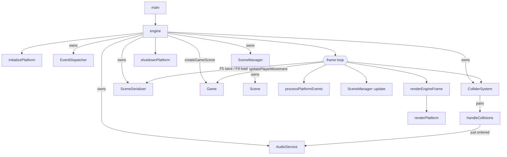

# Engine loop — Source Reference

> **Coverage:** Verified · **Source revision:** `phase3` @ `ca2b728` · **Last checked:** 2026-11-05
>
> **Files:** [`include/core/engine.h`](../../include/core/engine.h), [`src/core/engine.cpp`](../../src/core/engine.cpp) and [`src/main.cpp`](../../src/main.cpp).

**In one sentence:** `engine()` starts the platform and the engine systems, loads the demo scene from JSON, runs the input → move → update → collisions → trigger → render → save/reload loop until the window closes, then shuts down.

**Why it exists:** It is the heart of the program. It decides **the order** in which things happen each frame and **how long** objects live.

## At a glance

| This code… | Explanation |
| --- | --- |
| Is responsible for | Start-up, creating engine systems, the frame loop, delta time, save/reload keys, error catching, shutdown |
| Gets information from | The platform (events, asset folder, AssetManager), the system clock, [game](game.md) |
| Changes | Creates the `AudioService`, `EventDispatcher`, `ColliderSystem`, `SceneManager`, `SceneSerializer`; writes `phase3-demo-saved.json` |
| Used by | [`main`](#main), [EngineTest](../tests/test-engine.md) |
| Depends on | [platform](platform.md), [input](input.md), [logger](logger.md), [SceneManager](scene-manager.md), [EventDispatcher](event-dispatcher.md), [AudioService](audio-service.md), [ColliderSystem](collider-system.md), [SceneSerializer](scene-serializer.md), [game](game.md) |

## Contents — jump to an explanation

| Symbol | What it means | Jump |
| --- | --- | --- |
| `main()` | Program entry point | [Function](#main) |
| `engine()` | Whole engine lifetime | [Function](#engine) |
| `renderEngineFrame(SceneManager&)` | Draw the active scene | [Function](#renderengineframe) |

## Functions

### `int main()`

**What it does:** Calls [`engine()`](#engine), then returns `0`.

**Defined in:** [`src/main.cpp`](../../src/main.cpp). It includes `<SDL3/SDL.h>` and `<iostream>` without using them.

**Errors:** It always returns 0, even if the engine failed to start. `engine()` catches its own exceptions, so `main` never sees one in practice.

### `void renderEngineFrame(SceneManager& sceneManager)`

**What it does:** Gets the active scene and asks the platform to draw it.

| Name | Type | What the caller supplies | Rules |
| --- | --- | --- | --- |
| `sceneManager` | `SceneManager&` | The manager holding the active scene | Must have an active scene |

**Calls other project functions**

| Calls | Why | Where |
| --- | --- | --- |
| `SceneManager::getActiveScene` | Find what to draw | [getActiveScene](scene-manager.md#scenemanager-getactivescene) |
| `renderPlatform` | Clear, draw scene, present | [renderPlatform](platform.md#renderplatform) |

**Errors:** Throws `std::runtime_error` if no scene is active (from `getActiveScene`).

### `void engine()`

**What it does:** Runs the whole engine from start to finish.

**Returns:** Nothing. It returns early if start-up fails.

**Controls:** **W/A/S/D** move the player · walking into the trigger plays the sound · **F5** saves the scene · **F9** reloads the saved scene · closing the window quits.

**What happens, in order**

1. **Start-up.** `running = initializePlatform()` (this also creates the platform's [AssetManager](platform.md#getplatformassetmanager)). If it fails, it logs Error `Error occurred while initializing engine` and returns.
2. **Everything else runs inside `try { … }`** (see *Errors* below).
3. `initializeInput()`, then records `prev_time` in milliseconds.
4. **Inner scope `{ … }`** creates, in this order: `AudioService(getAssetRootPath())`, `EventDispatcher`, `ColliderSystem`, `SceneManager(eventDispatcher)`, `SceneSerializer`.
5. `savedScenePath = getAssetRootPath() / "scenes/phase3-demo-saved.json"` (next to the executable's assets, not the working directory).
6. `testSoundId = audioService.loadWav("audio/test.wav")` (`0` on failure, not fatal).
7. `sceneManager.setActiveScene(createGameScene(getPlatformAssetManager()))`: loads `phase3-demo.json`. One `SceneChangedEvent` is dispatched.
8. `bool wasOverlapping = false;`: remembers whether the player was inside the trigger last frame.
9. **Frame loop** (`while (running)`):
    1. Reads the time. `running = processPlatformEvents()`; on quit/close it `break`s.
    2. `delta_time = (current_time - prev_time) / 1000.0f` (seconds).
    3. [`updatePlayerMovement`](game.md#updateplayermovement)`(activeScene, delta_time)`: W/A/S/D move the player.
    4. `sceneManager.update(delta_time)`: components (animation) update.
    5. `collisionPairs = colliderSystem.detectCollisions(activeScene)`.
    6. `justEntered = handleCollisions(collisionPairs, activeScene, wasOverlapping)`. If true: logs `Player entered trigger!` and, if `testSoundId != 0`, plays the sound (Warning `Failed to play trigger sound` on failure).
    7. `renderEngineFrame(sceneManager)`.
    8. **F5** (`wasKeyPressed`): `sceneSerializer.save(activeScene, savedScenePath, getPlatformAssetManager())`. Logs `Scene saved to: …`, or Error `Failed to save Scene: …` (caught here, so the game keeps running).
    9. **F9**: if the saved file doesn't exist, Warning `No saved Scene found. Press F5 first.` Otherwise loads it **fully first**, then `setActiveScene(std::move(newScene))`, sets `wasOverlapping = false`, logs `Scene reloaded successfully!`. On any error: Error `Failed to reload Scene: …` and the **current scene stays**.
    10. `prev_time = current_time`.
10. **Leaving the scope** destroys, in reverse: `sceneSerializer` → `sceneManager` (scene, entities, components) → `colliderSystem` → `eventDispatcher` → `audioService`.
11. **Shutdown.** `shutdownPlatform()` (AssetManager → Renderer → window → SDL), after the `try`/`catch`, so it always runs.

**Calls other project functions**

| Calls | Why this call is needed here | Where to find it |
| --- | --- | --- |
| `initializePlatform` | Start SDL, window, renderer, AssetManager | [initializePlatform](platform.md#initializeplatform) |
| `initializeInput` | Get SDL's keyboard-state array | [initializeInput](input.md#initializeinput) |
| `logMessage` | Report failures, trigger entry, save/reload results | [logMessage](logger.md#logmessage) |
| `getAssetRootPath` | Root for sounds and the save file | [getAssetRootPath](platform.md#getassetrootpath) |
| `getPlatformAssetManager` | The shared path ↔ handle cache for loading and saving | [getPlatformAssetManager](platform.md#getplatformassetmanager) |
| `AudioService::AudioService` / `loadWav` / `play` | Sound | [AudioService](audio-service.md) |
| `createGameScene` | Load the demo scene from JSON | [createGameScene](game.md#creategamescene) |
| `SceneManager::setActiveScene` | Install the first scene, and the reloaded one | [setActiveScene](scene-manager.md#scenemanager-setactivescene) |
| `processPlatformEvents` | Handle input and detect quit | [processPlatformEvents](input.md#processplatformevents) |
| `updatePlayerMovement` | Move the player | [updatePlayerMovement](game.md#updateplayermovement) |
| `SceneManager::update` / `getActiveScene` | Update; access the scene | [update](scene-manager.md#scenemanager-update), [getActiveScene](scene-manager.md#scenemanager-getactivescene) |
| `ColliderSystem::detectCollisions` | Find overlapping pairs | [detectCollisions](collider-system.md#collidersystem-detectcollisions) |
| `handleCollisions` | Did the player just enter the trigger? | [handleCollisions](game.md#handlecollisions) |
| `renderEngineFrame` | Draw the frame | [renderEngineFrame](#renderengineframe) |
| `wasKeyPressed(Key::F5 / Key::F9)` | One save/reload per key press | [wasKeyPressed](input.md#waskeypressed) |
| `SceneSerializer::save` / `load` | F5 / F9 | [save](scene-serializer.md#sceneserializer-save), [load](scene-serializer.md#sceneserializer-load) |
| `shutdownPlatform` | Release everything | [shutdownPlatform](platform.md#shutdownplatform) |

### Local variables

| Name | Type | Meaning |
| --- | --- | --- |
| `running` | `bool` | Start-up result; then "keep looping" |
| `delta_time` | `float` | Seconds since the previous frame (millisecond resolution) |
| `prev_time`, `current_time` | `auto` (`long long` ms) | Clock readings for delta time |
| `audioService` | `AudioService` | Sound cache and playback; destroyed last of the systems |
| `eventDispatcher` | `EventDispatcher` | Event hub; must outlive `sceneManager` |
| `colliderSystem` | `ColliderSystem` | Stateless overlap checker |
| `sceneManager` | `SceneManager` | Owns the active scene |
| `sceneSerializer` | `SceneSerializer` | Used by F5/F9 |
| `savedScenePath` | `const std::filesystem::path` | `<exe folder>/assets/scenes/phase3-demo-saved.json` |
| `testSoundId` | `const AudioService::SoundId` | ID of `audio/test.wav`, or `0` |
| `wasOverlapping` | `bool` | Was the player in the trigger last frame? Reset on reload. |
| `collisionPairs`, `justEntered` | per frame | This frame's overlaps; "entered this frame?" |

**Why the inner `{ }` scope matters (lifetime ordering):**

- C++ destroys local objects in **reverse** order. `eventDispatcher` is declared before `sceneManager`, so it outlives it (the manager holds a reference to it).
- Everything in the scope (scenes, the audio stream) is destroyed **before** `shutdownPlatform()`. Scenes hold texture **handles** from the platform's AssetManager/Renderer, which are destroyed only in `shutdownPlatform()`.

**Why save/reload happen after rendering:** swapping the scene at the **end** of the frame ("frame boundary") means nothing earlier in the frame is still using the old scene's entities.

**Errors and edge cases:**

- **Exceptions are caught.** `catch (const std::exception&)` logs `Engine error: <message>`; `catch (...)` logs `An unknown error occurred in the engine`. `shutdownPlatform()` still runs. Example: `phase3-demo.json` missing or invalid at start-up.
- **Save/reload errors are caught locally** and never stop the game.
- A failed sound load just means the trigger is silent.
- The first `delta_time` includes the start-up time, so the first animation step (and first movement step) may jump.

**Related tests:** [EngineTest](../tests/test-engine.md).

## Dependencies and interactions

## Things worth knowing

- `engine.h` has **no `#pragma once`**.
- The saved file goes into `build/bin/assets/scenes/` (next to the executable), not into the repository's `assets/`. Deleting `build/` deletes the save.
- F9 reloads the **saved** file, not the original `phase3-demo.json`.

**Back to:** [Code index](index.md) · [Symbol index](symbol-index.md)
