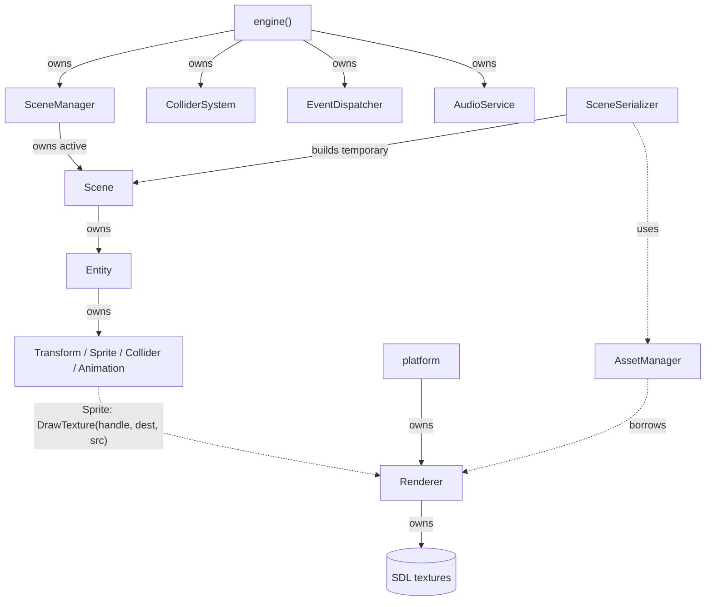

# Phase 3 Decisions: Plan vs What Shipped

> **Status:** written against the `phase3` branch (AssetManager, animation, serializer, collision and audio merged). Update the *Not done yet* table after the integration and verification tickets.

The Phase 3 design document was a **proposal**. This page records where the code matches it, where it differs, and why. Nothing here describes an unbuilt feature as finished.

## Ownership and frame flow (as built)

Solid arrows = ownership; dotted = borrowed / used.

**One frame** (`src/core/engine.cpp`):

1. `processPlatformEvents()`: input; quit/close stops the loop
2. `wasKeyPressed(Key::Space)` → `audioService.play(testSoundId)`
3. `sceneManager.update(dt)`: components update; animations set the sprite's source rectangle
4. `colliderSystem.detectCollisions(activeScene)`: after positions are updated
5. `handleCollisions(pairs)`: gameplay reaction (currently logs each pair)
6. `renderEngineFrame()`: clear, each sprite draws, present

**Startup:** `initializePlatform()` (SDL video, audio optional, window, Renderer) → `initializeInput()` → `AudioService`, `EventDispatcher`, `ColliderSystem`, `SceneManager` → `setActiveScene(createGameScene())`.

**Shutdown:** leaving the inner scope destroys, in reverse order, `SceneManager` (and the scene) → `ColliderSystem` → `EventDispatcher` → `AudioService`; then `shutdownPlatform()` destroys the Renderer (and textures), the window, and SDL. Any exception is caught and logged, and `shutdownPlatform()` still runs.

## Matches the plan

| Plan | Code |
| --- | --- |
| One cached texture per path | `AssetManager::loadTexture` returns the existing handle for the same normalized path |
| Renderer owns textures | `Renderer::textures`; freed in `~Renderer` |
| Relative, portable paths; reject absolute and `..` | `AssetManager` (textures) and `AudioService` (sounds) normalize the same way |
| Failed loads not cached | `Renderer::LoadTexture` throws before anything is stored; `loadWav` returns `0` |
| Reverse lookup for saving | `AssetManager::getPath(handle)` |
| JSON, schema version 1, one pinned parser | nlohmann/json `v3.11.3` via `FetchContent` |
| No IDs, handles, pointers, or animation progress saved | see [scene-format.md](scene-format.md#what-is-never-saved) |
| Load into a temporary Scene; caller activates | `SceneSerializer::load` returns `std::unique_ptr<Scene>` |
| Failed load keeps the active Scene; no event | `FailedLoadKeepsOldSceneAndEmitsNoEvent`, `FailedColliderLoadDoesNotReplaceActiveSceneOrEmitEvent` |
| Safe save via temp file | `<dest>.tmp`, then `std::filesystem::rename` |
| Collider: local offset + size, world bounds from current Transform | `ColliderComponent` + `getWorldBounds` in `colliderSystem.cpp` |
| Strict AABB overlap: touching edges/corners is not a collision | `overlaps()` uses `>` / `<` |
| Each unordered pair once, IDs not pointers, skip disabled / no Transform / invalid | `ColliderSystem::detectCollisions` (`j = i + 1`) |
| Detection only; gameplay decides the reaction | `handleCollisions` in `game.cpp` |
| Animation: per-component timer, carries leftover time, loops | `AnimationComponent::update` |
| Source rectangle chosen by animation, drawn by Sprite/Renderer | `Sprite::sourceSet` → `Renderer::DrawTexture(handle, dest, src)` |
| Short WAV effects, one at a time, missing file / no device handled | `AudioService`; engine keeps running without sound |
| Sound on key **press**, not hold | `wasKeyPressed(Key::Space)` |
| Read-only Scene traversal | `Scene::getEntities() const`, `Scene::getSceneName() const` |

## Deviations (with reasons)

| # | Plan said | We did | Why |
| --- | --- | --- | --- |
| 1 | Animation configured by frame size, frame count and **frames per second** | An explicit **list of frame rectangles** plus **`frameDuration`** (seconds per frame) | Matches the `AnimationComponent` constructor directly; works for sheets whose frames aren't one even row; seconds-per-frame is what the timer uses |
| 2 | Return or report failures (open) | `SceneSerializer::load`/`save` **throw** `std::runtime_error` with file, entity and field | Simple with `try/catch`; guarantees no half-built scene is returned |
| 3 | Reject invalid components | Also reject **unknown fields** and **duplicate keys** | Typos like `"widht"` would otherwise be silently ignored; nlohmann keeps the last duplicate by default |
| 4 | Sprite optional per entity (implied) | `transform` and `sprite` are **required** in version 1 | Every entity the engine currently draws needs both; keeps v1 simple; can be relaxed later |
| 5 | Guard against out-of-bounds source rectangles | Frame sizes must be > 0 at load, but the frame is **not** checked against the texture size until draw time | Avoids needing texture dimensions while parsing; `DrawTexture` skips and logs invalid frames |
| 6 | Dimensions available for drawing | `Renderer::getTextureDimensions` → `std::pair<float, float>`; `AssetManager::getOriginalDimensions` → `std::pair<int, int>` | SDL reports float sizes; AssetManager kept an int API. Texture sizes are whole pixels |
| 7 | Entity const lookup coordinated | `Entity::getComponent` is still **non-const** | Callers reach entities through `std::unique_ptr`, which still allows it. A `const` overload helps the Phase 4 inspector |
| 8 | Trigger-on-enter requires comparing pairs | Collisions are reported **every frame** while overlapping; `handleCollisions` only logs | Detection was the Phase 3 goal; enter/exit tracking is left to gameplay |
| 9 | Define what happens when a sound is requested while one plays | `AudioService::play` **clears the stream and restarts** with the new sound | Simplest consistent rule for "one sound at a time" |
| 10 | Short WAV effects | WAVs longer than **5 seconds** are rejected; total cache size is capped | Keeps memory bounded; music streaming is out of scope |
| 11 | Audio failure shouldn't crash the engine | SDL audio failing to start is only a **warning**; `loadWav` returns `0` and the engine skips playback | Visual demo works without a sound device |
| 12 | (Phase 1) `game_tests` executable | Removed; `createGameScene()` and `handleCollisions()` replaced the old cat/chef demo | The old tests covered code that no longer exists |

## Not done yet (do not document as working)

| Item | Notes |
| --- | --- |
| Engine startup loading the demo **from JSON** | `createGameScene()` still builds it in code |
| Engine using **AssetManager** for its own textures | `createGameScene()` uses `loadPlatformTexture("assets/...")`, which is relative to the **working directory**, so run the demo from the repo root |
| Trigger enter/exit events and a sound on overlap | Only logging today |
| Demo collision | The two demo colliders sit edge to edge (x 50–100 and 100–150), so by the strict rule **no collision is logged** until one moves |

## Notes for Phase 4 (editor)

- The inspector can read a scene with `Scene::getEntities()` and each entity's `getComponent<T>()`.
- Colliders already have getters and setters (`setLocalBounds`, `setEnabled`); Transform fields are public.
- Editing a Transform or Collider and calling `SceneSerializer::save` round-trips (tested).
- Useful additions: a `const` `getComponent`, removing entities, and getters for `Sprite` source rectangles.
