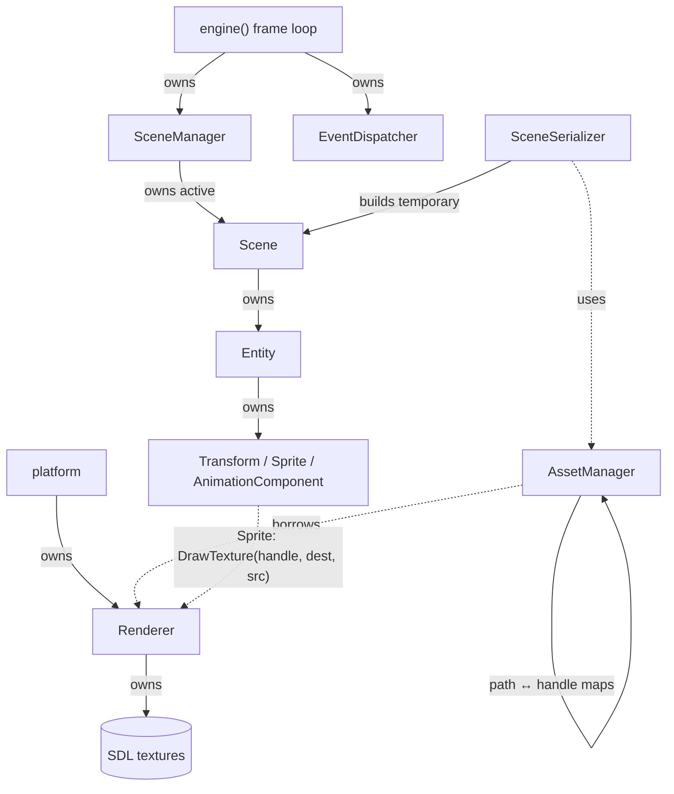

# Phase 3 Decisions: Plan vs What Shipped

> **Status:** draft. Written from `feature/phase3-scene-serialization` (which already merges AssetManager and animation). Finalize after the integration and verification tickets; sections marked *TBD* need Yassmine's merged code.

The Phase 3 design document was a **proposal**. This page records where the real code matches it, where it differs, and why. Nothing here describes an unbuilt feature as finished.

## Ownership and frame flow (as built)

Solid arrows = ownership; dotted = borrowed reference.

**One frame:** poll input → `SceneManager::update(dt)` (animations advance and set the sprite's source rectangle) → render (clear, each sprite draws, present). Collision and gameplay reactions will sit between update and render (*TBD*).

**Lifetime order:** Renderer and window are created first; scene objects are destroyed inside `engine()`'s inner scope **before** `shutdownPlatform()` destroys the Renderer and its textures. Sprites only hold texture **handles**, so nothing dangles. `AssetManager` must also be destroyed before the Renderer, because it holds a `Renderer&`.

## Matches the plan

| Plan | Code |
| --- | --- |
| One cached texture per path | `AssetManager::loadTexture` returns the existing handle for the same normalized path |
| Renderer owns textures | `Renderer::textures`; freed in `~Renderer` |
| Relative, portable paths; reject absolute and `..` | `AssetManager::normalizePath` |
| Failed loads not cached | `Renderer::LoadTexture` throws before anything is stored |
| Reverse lookup for saving | `AssetManager::getPath(handle)` |
| JSON, schema version 1, one pinned parser | nlohmann/json `v3.11.3` via `FetchContent` |
| No IDs, handles, pointers, or animation progress saved | see [scene-format.md](scene-format.md#what-is-never-saved) |
| Load into a temporary Scene; caller activates | `SceneSerializer::load` returns `std::unique_ptr<Scene>`; caller calls `setActiveScene` |
| Failed load keeps the active Scene; no event | tested in `FailedLoadKeepsOldSceneAndEmitsNoEvent` |
| Safe save via temp file | `<dest>.tmp`, then `std::filesystem::rename` |
| Animation: per-component timer, carries leftover time, loops | `AnimationComponent::update` |
| Source rectangle chosen by animation, drawn by Sprite/Renderer | `Sprite::sourceSet` → `Renderer::DrawTexture(handle, dest, src)` |
| Read-only Scene traversal | `Scene::getEntities() const`, `Scene::getSceneName() const` |

## Deviations (with reasons)

| # | Plan said | We did | Why |
| --- | --- | --- | --- |
| 1 | Animation configured by frame size, frame count and **frames per second** | An explicit **list of frame rectangles** plus **`frameDuration`** (seconds per frame) | Matches the `AnimationComponent` constructor directly; supports sheets whose frames aren't in one even row; seconds-per-frame is what the timer uses |
| 2 | Return or report failures (open) | `load`/`save` **throw** `std::runtime_error` with file, entity and field in the message | Simple to use with `try/catch`; guarantees no half-built scene is returned |
| 3 | Reject invalid components | Also reject **unknown fields** and **duplicate keys** | Typos like `"widht"` would otherwise be silently ignored; nlohmann keeps the last duplicate by default |
| 4 | Sprite optional per entity (implied) | `transform` and `sprite` are **required** in version 1 | Every entity the engine can currently draw needs both; keeps v1 validation simple. Can be relaxed in a later version |
| 5 | Validate source rectangles | Frame rectangles are **not** checked against texture size at load; `DrawTexture` skips invalid ones and logs a warning | Avoids needing texture dimensions during parsing; failure is visible but not fatal |
| 6 | Dimensions available for drawing | `Renderer::getTextureDimensions` returns `std::pair<float, float>`; `AssetManager::getOriginalDimensions` returns `std::pair<int, int>` | SDL reports float sizes; AssetManager kept its int API. Texture sizes are whole pixels, so nothing is lost |
| 7 | "Entity const lookup" coordinated | `Entity::getComponent` is still **non-const** | `save` reaches entities through `std::unique_ptr`, which still allows the call. A `const` overload is worth adding for the Phase 4 inspector |
| 8 | Serializer API shape (open) | A small `SceneSerializer` class with `load` and `save` members | Groups the two operations; easy to fake later if needed |

## Not done yet (do not document as working)

| Item | Owner | Status |
| --- | --- | --- |
| `ColliderComponent`, collision pass, `collider` in scene files | Yassmine | *TBD* |
| Audio service + key-press sound | Yassmine | *TBD* |
| Engine startup loading the demo from JSON (still built in `engine.cpp` with `loadPlatformTexture`) | Integration ticket | *TBD* |
| `loadPlatformTexture` paths are relative to the **working directory**, not the asset root | Integration ticket | Demo must be run from the repo root until then |

## Notes for Phase 4 (editor)

- The inspector can read a scene with `Scene::getEntities()` and each entity's `getComponent<T>()`.
- Editing a Transform and calling `SceneSerializer::save` already round-trips (tested).
- Useful additions: a `const` `getComponent`, a way to remove entities, and getters on `ColliderComponent` once it exists.
